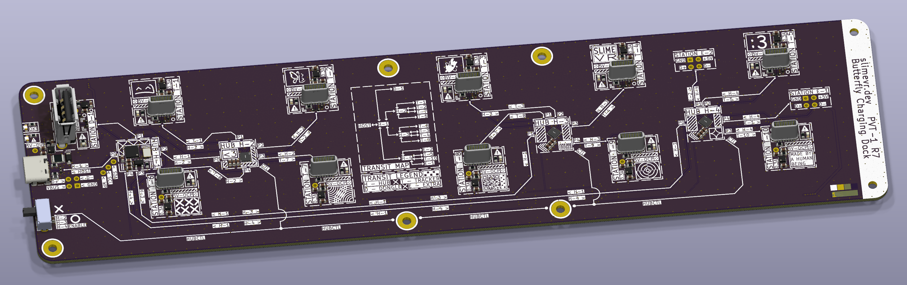

# SlimeVR Morpho Charger
Charging dock for SlimeVR Butterfly trackers. Ten tracker stations and a dongle port behind four cascaded USB hubs, so trackers charge and stay reachable over USB.

## License
The hardware design in [`pcb/`](pcb) (schematics, PCB layout, symbol and footprint libraries) is licensed under the
CERN Open Hardware Licence Version 2 - Permissive ([LICENSE-CERN-OHL-P](LICENSE-CERN-OHL-P) or https://ohwr.org/cern_ohl_p_v2.txt).

Everything else, including the EEPROM tooling in [`eeprom/`](eeprom), is dual-licensed under either:

- MIT License ([LICENSE-MIT](LICENSE-MIT) or https://opensource.org/license/mit/)
- Apache License, Version 2.0 ([LICENSE-APACHE](LICENSE-APACHE) or https://opensource.org/license/apache-2-0/)

at your option.
